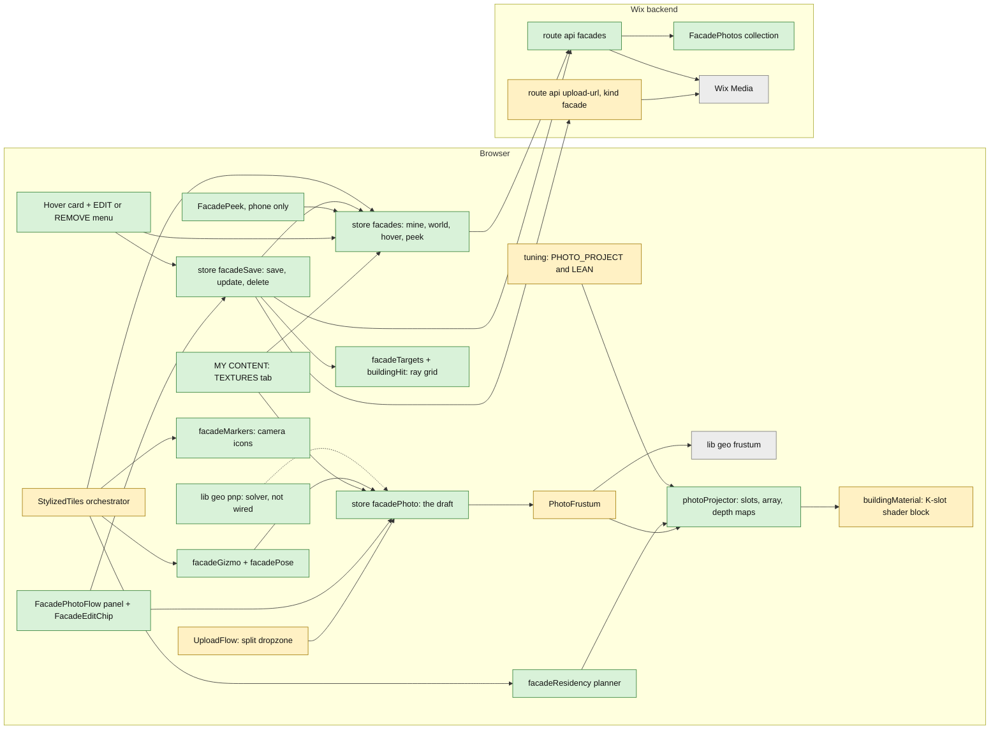

# Design Record: building textures (the facade photo projection pipeline)

**Status: FINAL (2026-10-24).** Sections 1 to 6 are the record: what was built, what the owner asked for, what the owner
still has to decide, the terms, the component diagram and the flows. Sections 7 to 15 are the evidence it rests on (the
timeline, the files, the data contract, the decisions with their rejected alternatives, the numbers with a confidence per
claim, the gaps, the risks), gathered on 2026-10-23 from the code and the records with `file:line` citations and kept as
gathered; §12 (the confidence table), the last timeline row and the closing note of §15 were added at finalisation.

How to read: D = `.claude/claude-docs/DECISIONS.md` (line numbers as of 2026-10-23), BL = the tracked backlog
(`.claude/skills/frame/references/tracked-backlog.md`; row Tn sits at line 192 + (n − 165)), PLAN =
`PHOTO_PROJECTION_PLAN_2026-10-21.md`, GT = `conventions/globe-tuning.md`, CT = `conventions/contracts.md`,
mem = `.serena/memories/project/`, ST = `src/components/globe/StylizedTiles.ts`. Paths without a root are under `src/`.

## 1. Overview: what was built, why, and the verdict

**Verdict: building textures are live on plux.today (v1.36.42, 2026-10-23) and work on desktop; the phone tier is
view-only and has never been measured on a real phone.** The live verifier passed 12 of 12 legs on the deployed site,
including a signed-out visitor streaming another member's texture (§8, the harnesses line).

What it is. A signed-in member uploads a street photo, places it where it was taken, fits its camera pose with a gizmo,
and saves it. PLUX then paints that photo onto the real 3D buildings for every visitor, as if a slide projector stood
where the camera stood. A depth map rendered from the photo's own camera keeps the paint off walls the camera could not
see. Nothing is baked: the server stores the pose and a 2048-px copy of the photo, and each browser re-projects it at
runtime onto the one shared building material (§10, rows 10-13 and 10-18).

Why. The owner asked on 2026-10-13 for the member's photo to be projected onto the buildings from its own camera,
persisting the pose, not a bake (§2). On 2026-10-21 he set the budget: "hundreds per city, maybe thousands; not huge, not
blurry", 100+ MB of GPU acceptable on desktop, no degradation on the phone (§2).

How it was built. A one-photo prototype (2026-10-18), then six slices up to 2026-10-23 (§7): F1 the gizmo, F2 saving
(`FacadePhotos` + `/api/facades`), F3 residency (many saved photos, a few painted at once), F4 one array texture holding up
to 6 photos, F5 the building ids each photo paints (recorded at save), and F6 a view-only phone tier holding 2 photos.

What is true on 2026-10-24.
- PR #155 is merged (squash `85982df`); v1.36.42, released from its branch before the merge, is live.
- Every visitor sees every member's textures, signed out and unmoderated (owner ruling 2026-10-22g, T190). This waives
  the C6 moderation gate for textures only. The photo PINS still follow C6: reduced precision and moderation.
- Two fixes are on master and not yet released: the UI copy now says a texture is PUBLIC (T193) and SAVE re-sends the
  record when Wix Media answers 409 `FILE_NOT_READY` (T194).
- The drifting saved-place pins (T195) are fixed on master on 2026-10-24, unreleased: the pins' ground seat latched the first in-range terrain answer, which at a high boot comes from a coarse tile (4 to 9 m off in Dnipro), and never refined; `refineGroundSeat` (`lib/geo/terrain.ts`) now moves a seat only to a finer tile. Not a texture defect; §2 holds the owner's report.

What is not done. No real-phone measurement (PLAN:106-107 asks for one before any release). The pose solver
(`lib/geo/pnp.ts`) is tested but only its test imports it (`test/lib/geo/pnp.test.ts:11`). No in-app way to withdraw a
texture: the `REMOVED` state is never set by code (§13). The desktop frame cost of the shader is unknown, because the
measurement was capped by vsync (§11).

## 2. Requirements: what the owner has said (verbatim where recorded)
- 2026-10-13 triage §4: project the member's street photo onto the buildings from its own camera; persist the pose, not a bake.
- 2026-10-21: "looks promising"; release held until SAVE exists; "100+ MB of GPU for live photos is acceptable; do not trade sharpness" on desktop; the phone must not degrade; "hundreds per city, maybe thousands; not huge, not blurry".
- 2026-10-22 (the seven asks): a corner-only SCALE must re-project; residency by what the photo PAINTS, with a graceful fade; editing in FPV; quick op buttons; camera-icon markers with a hover card and EDIT / REMOVE; a TEX toggle; the Upload split; MENU; MY CONTENT · TEXTURES.
- 2026-10-22g (the five asks): fade from 2 km (ruled 2 → 3 km); "same as with meshes" ops (= the G / R / S hotkeys + one row per op); location-pin place markers; **T190 — every visitor sees every member's textures, signed out, unmoderated: the explicit C6 waiver for textures**; the /m LAYERS modal; F6 view-only on the phone under a measured budget.
- 2026-10-23: "I will be testing and provide full feedback in later sessions" — and one bug already found: **the new place pins drift / float when the camera moves, orbit and FPV (T195)**.

## 3. Open questions for the owner on building textures

Six decisions are open. Each one below says why it exists, what this record suggests, and the alternatives. The owner
decides all six; nothing in this record pre-empts them.

### 3.1 How far should the photo-to-building alignment UI go (F5's second half)?
Why it exists. A phone's GPS is off by 3 to 15 m against the box-shaped buildings (§14), so a texture often lands beside
its wall until the member drags it into place. A solver that computes the pose from point pairs exists
(`solveFacadePose`, `lib/geo/pnp.ts:461`) but no UI calls it; the `alignment` field and the `SOLVED` pose source stay
empty (§13).
Suggested: the proposal recorded in mem `wip-2026-10-23-owner-asks-build-t187-t191-f6.md`. The panel gets a PAIRS list
(click a point on the photo, then the matching point on a building), a SOLVE button from 4 pairs, an optional
solve-the-field-of-view checkbox from 6 pairs, and the result is written as one undoable edit with `poseSource: "SOLVED"`.
Alternatives:
- Keep the gizmo as the only fitting tool. No build cost; every texture stays hand-fitted.
- Build the pairs UI. On synthetic data the solver lands within 0.39 m / 0.60° with 12 pairs at 1 px of click noise (§11).
  On a single flat wall, yaw and sideways position trade off against each other, so the UI must ask for a corner point.
  Accuracy on real photos is not measured.
- An automatic feature detector. Out of scope for the client today; not measured.

### 3.2 Should the public texture read page past 200 rows per query (T192)?
Why it exists. The world read answers one page of at most 200 rows, oldest first, and returns `complete: false` when a
cell holds more; the client carries the flag and does nothing with it (`api/facades.ts:62-66`, BL T192). A visitor in an
overfull cell sees the oldest 200 textures.
Suggested: leave it until a cell gets close to 200. BL T192 records that no city holds 200 textures in one geohash-5 cell
today.
Alternatives:
- Page on `complete: false`. Every texture shows; each overfull cell costs extra unauthenticated, elevated queries, which
  adds to the read-amplification risk in §14.
- Switch an overfull cell to smaller geohash-6 cells. Fewer rows per query; a cover then needs more cells, against the
  32-cell cap and the 16 cells per query (`store/facades.ts:31-33`).

### 3.3 What budget must a real phone meet before the next release that touches the phone tier?
Why it exists. The plan requires a device-farm run on the iPhone 17 Pro "before any release" (PLAN:106-107). The phone
tier shipped in v1.36.42 measured only on an iPhone emulated in desktop Chrome (§11, §13).
Suggested: one farm run on the iPhone 17 Pro that reads the frame time with textures on and off, the time to upload one
1024-px layer, the 11.2 MB photo array, and any memory warning, then a numeric budget the owner signs off.
Alternatives:
- Accept the emulated numbers. No cost now; a real-phone slowdown, which the owner ruled out on 2026-10-21, would go
  unseen.
- Show markers only on the phone (no painted textures) until the farm run. Removes the risk; removes the F6 view the
  owner asked for.

### 3.4 Two editor tails: the orphaned overlay screens (T184) and which edits UNDO covers (T185)
Why they exist. T184: the facade overlay's own drop screen and its "my facades" list are reachable only through a store
call since the Upload split and MY CONTENT · TEXTURES replaced them (BL T184). T185: only gizmo drags and the per-op ↺
reset are undoable; the panel's nudges and sliders write the pose without an undo entry (BL T185).
Suggested: retire the orphaned screens (one way in: the Upload split and MY CONTENT), and record one undo entry per
slider release and per nudge click, so UNDO always reverses the last visible change.
Alternatives:
- T184: keep the screens as the overlay's empty state. No harness change; dead UI stays in the bundle.
- T185: keep gizmo-only undo. No work; a member who moves a slider cannot undo it, and the pin flow's panel behaves the
  same way today.

### 3.5 Should GPU-compressed textures (KTX2) be revisited now that the phone tier exists?
Why it exists. KTX2 was rejected for v1 because the in-browser encode took 5.5 to 7.6 s (ETC1S), 12.5 s (UASTC) and
36 s (UASTC with RDO) per photo on the M3, and ETC1S arrives on desktop as 8 bits per pixel, no smaller than today (§10,
row 10-21/22e). The plan said to revisit it with F6; that was not done (§13).
Suggested: do not revisit now. The phone's photo array is 11.2 MB (§11); revisit if K grows or the farm run in §3.3 shows
memory pressure.
Alternatives:
- Measure a worker-threaded encode now. Costs one probe session; the plan's estimate of 4 to 6 times less GPU memory per
  photo is not measured.

### 3.6 How should a harmful public texture be taken down (moderation and `REMOVED`)?
Why it exists. Since T190, any visitor, signed out, can read every texture's exact camera position and its photo URL
(§14). The world read withholds rows whose `moderation` is `REMOVED`, but no code sets `REMOVED`; the only way is a manual
edit in the Wix dashboard (§13). The code-review bot raised the public read as a P0 on PR #155; the owner's ruling stands.
Suggested: an owner-only REMOVE action on any marker that sets `moderation: "REMOVED"` through a gated route, so a texture
can be withdrawn from the globe in one click without the dashboard.
Alternatives:
- Keep the manual dashboard edit. No build cost; slower to act on a report.
- A moderation queue before a texture goes public. Reverses the T190 ruling and delays every save.
- A visitor "report" button feeding the owner. Adds a write route open to signed-out visitors.

## 4. Terms used in this record

| Term | Meaning (from the code) |
|---|---|
| apex | The point the photo was taken from: the tip of its frustum (`frustumGeometry`, `lib/geo/frustum.ts:63`), stored as `lat` / `lon` + `apexAltM`, the rendered height above the ellipsoid at save (CT). |
| painted volume | The cone from the apex along the photo's view direction, as long as its paint range, widened to the photo's corners; residency measures the camera's distance to it, 0 inside (`facadePaintedVolume`, `facadeVolumeDistanceM`, `lib/globe/facadeResidency.ts:90, 115`). |
| slot | One of K projector records; a slot holds a photo's projection matrix, its depth map and one layer of the array. K is compiled into the building shader as K unrolled blocks: 6 on desktop, 2 on the lean tier (`tuning.ts:3673, 3742`). |
| residency | The rule that picks which saved photos get a slot: in view, within `slotRangeM` 3,000 m of the painted volume, with a fade over the last third and margins both ways so photos do not flicker in and out (`planFacadeSlots`, `facadeSlotFade`, `facadeResidency.ts:231, 162`; `tuning.ts:3687-3691`). |
| the array | One `DataArrayTexture` with K square layers of `layerPx` (2048 desktop, 1024 lean); each photo is stretched to its layer; allocated on the first photo load (`ensurePhotoArray`, `photoProjector.ts:454-470`; the layer copy at :516). |
| the lean tier | `PHOTO_PROJECT_LEAN`, the overrides used on the /m shell and on coarse-pointer devices: 2 slots, 1024-px layers, 512-px depth maps, a 2 s depth refresh, a 3 km read radius (`tuning.ts:3741-3760`; chosen once at `ST:541-543`). |
| the peek | The /m card a tap on a texture marker opens: thumb, title, pose line, and ◎ LOOK, which jumps the first-person camera to the apex (`mobile/FacadePeek.tsx:47-58`; `peekFacadeAt`, `ST:1890-1908`). |
| the draft | The photo being placed or edited; on desktop it always holds slot 0 (`DRAFT_SLOT_ID`, `photoProjector.ts:147, 359`); the lean tier has no draft slot (a detached record that never renders). |
| marker | The camera-icon billboard drawn at every saved texture's apex, at most 1,000 (`FACADE_MARKER_CAP`, `scene/facadeMarkers.ts:41`). |
| world read | `GET /api/facades?cells=`: the public, signed-out read of every texture in a set of geohash-5 cells around the view (`api/facades.ts:55-66`). |

## 5. Component diagram of building textures

Green = new for building textures, amber = an existing part changed for them, grey = used unchanged. Arrows point from the
caller to what it calls or writes.

The dashed arrow is the planned link from §3.1. The file behind each box, with line ranges, is in §8.

## 6. User flows for building textures

### 6.1 Desktop author: upload, review, place, fit, save
1. The member drops a photo on the lower half of the Upload dropzone (T181). The facade overlay opens and decodes it
   (`store/facadePhoto.ts:37`, phases `idle`, `decoding`, `review`).
2. Review shows the EXIF pose. PLACE puts it on the globe at its GPS position; without GPS the phase is `placing` and a
   click on the globe sets the position (`facadePhoto.ts:331`).
3. Placed: the frustum appears, the draft takes slot 0 and paints the buildings, and the camera flies to frame it. In
   first-person view there is no flight; the eye jumps to the apex instead (T186).
4. Fit: the gizmo moves, rotates and scales (scale changes the field of view, never stretches the photo) with a gain of 0.5 on
   every drag (GT), by mouse or by the G / R / S keys; the chip shows one row per operation with a ↺ reset; the
   sliders are the precise twin. UNDO covers gizmo drags and ↺ only (§3.4).
5. SAVE runs the save walk (`store/facadeSave.ts:135-223`): the original goes to private Media by TUS (a failure becomes a
   warning); the browser makes a 2048-px JPEG and a 512-px thumb and uploads both as public files (the 2048-px copy is
   required); a 7 × 5 ray grid records the building ids the photo hits; the record is POSTed. On 409 `FILE_NOT_READY` the
   same body is re-sent up to 6 times, 1.5 s apart (`FACADE_SAVE_RETRY`, :73; T194, on master, not released). The server
   copies the image URLs off descriptors it verified itself.
6. Saved: SAVE becomes UPDATE, the row joins MINE and is hidden from residency while it is the open draft (:214-219).

### 6.2 Desktop visitor viewing textures, signed in or out
1. As the camera moves, the facades store plans a cover of geohash-5 cells around the view (half-side 6 km, at most 32
   cells) and, throttled to one call per 600 ms, sends `GET /api/facades?cells=` in chunks of 16 cells; it re-polls every
   90 s and drops everything above 25 km altitude (`store/facades.ts:320-345`; `tuning.ts:5276-5278`).
2. The route answers up to 200 rows per call, oldest first, without any owner or member id (`api/facades.ts:55-66`).
3. Every row becomes a camera-icon marker. Every 12 frames residency picks up to 5 saved photos (slot 0 stays reserved
   for the draft); each photo is decoded, stretched to its 2048-px layer and copied in (about 24 ms on the main thread),
   and its depth map is rendered from its apex, at most one depth render per frame. Paint fades out between 2 and 3 km.
4. Hover shows a card (thumb, title, pose). Right-click opens EDIT / REMOVE, disabled unless the row is the member's own
   (`panels/FacadeMarkerMenu.tsx:39-80`). A left click opens the member's own texture in the editor; a click on someone
   else's texture does nothing on the facade path (`ST:2484-2494`).
5. The TEX chip off releases every saved slot; the markers stay (GT, T182).

### 6.3 Phone (/m) visitor viewing textures
1. At start the orchestrator picks the lean tier for the /m shell or a coarse-pointer device (`ST:541-543`): 2 slots, no
   draft slot, 1024-px layers, 512-px depth maps refreshed every 2 s, a 3 km read radius.
2. The world read and the markers work as on desktop; markers are drawn twice as large for touch (0.04 rad).
3. Residency paints up to 2 saved photos (11.2 MB of photo memory).
4. A tap on a marker, in orbit or first-person view, opens the peek; ◎ LOOK jumps the first-person camera to the apex and
   closes the peek; ✕ closes it (`FacadePeek.tsx:53-58`).
5. The 2D map releases every slot. There is no upload, gizmo, hover card or menu on the phone; the TEXTURES cell of the
   LAYERS modal is the TEX switch (T191).

### 6.4 Update and delete (owner only)
1. The owner opens a saved texture from MY CONTENT · TEXTURES with OPEN, by a left click on its marker, or by EDIT in the
   marker menu. `openSaved` makes it the draft again (`facadePhoto.ts:399`).
2. UPDATE sends a PATCH with the edited fields; building ids ride only when the probe found some, so a re-save before the
   tiles stream in keeps the old set (`lib/save/facadeBody.ts:108`). The server rewrites the whole row and re-derives the
   geohashes and the pose source (CT).
3. DELETE (the panel) or REMOVE (the menu, two presses within 4 s) sends `DELETE ?id=`. The server removes the row first,
   then deletes the three Media files best-effort, so orphaned files are possible (`api/facades.ts:189-205`). The client
   drops the row from MINE and clears the draft if it was open (`facadeSave.ts:269-286`).
4. Other visitors see the change on their next world read: a cover change or the 90 s re-poll.

## 7. Timeline of the building-textures work

| Session | What landed | Version | Key |
|---|---|---|---|
| 2026-10-13 | Triage §4 designs flow (b): a SpotLight.map spike, then the "real path" with ≤ 4 projectors (BUILDING_COLOUR_TRIAGE:64-88); backlog T157 | — | BL:184 |
| 2026-10-18 | Prototype: one slot, per-PASS view-space matrix, depth map, `?facade=1`, desktop `hqAllowed` only | not released (PR #145 → `b644ecd`) | D 2026-10-18 |
| 2026-10-21 | Owner read "looks promising". PLAN F1–F6 written; release HELD until SAVE exists | plan only | D 2026-10-21, PLAN:96-107 |
| 2026-10-22 | F1 gizmo, F2 persist (`FacadePhotos`, `/api/facades`), F3 residency, T171 K = 4 unrolled slots | v1.36.33 (ship `ab4a87b`, behind `?facade=1`) | D 2026-10-22 ×2 |
| 2026-10-22b/c | The seven asks recorded (T174–T183); T182 /m toggle ruled "present but inert"; persistence may be tested live (T173) | — | D 2026-10-22b/c |
| 2026-10-22d | T174–T183 built: 21-float pose signature, painted-volume residency + fade, FPV editing, chip, camera-icon markers, hover card, menu, TEX toggle, split dropzone, MENU, MY CONTENT | PR #150 | D 2026-10-22d |
| 2026-10-22e/f | F4 array texture (K 6, `layerPx` 2048), F5 `targetFeatureIds` ray grid, T186 FPV-at-apex | v1.36.38 (PR #151, `bb7da92`) | D 2026-10-22e/f |
| 2026-10-22g/h | Live read, five asks (T187–T191), **T190 ruling: textures PUBLIC**, F6 view-only ordered; fade ruled 2 → 3 km | records only | D 2026-10-22g/h |
| 2026-10-23 | T187–T191 + F6 lean tier + the pure PnP solve (`lib/geo/pnp.ts`) | — | D 2026-10-23 |
| 2026-10-23b/c/d | Released; T190 proven live; codebot review fixes; second release; the live verifier 12/12 | v1.36.42 (ship `0bcb7ed` + `26febba`); **PR #155 OPEN, REVIEW_REQUIRED** | D 2026-10-23b/c/d |
| 2026-10-23e | DRAFTS (this file, the guide chapter); fixes T193 (the UI copy said PRIVATE), T194 (SAVE retries the 409); T195 recorded (the drifting place pins) | uncommitted → the ship branch | D 2026-10-23e |
| 2026-10-24 | PR #155 merged (squash `85982df`); T193 / T194 / T195 on master, unreleased; this record finalised | v1.36.42 still live | mem `wip-2026-10-24-t195-adr-guide-release.md` |

## 8. Component map: files, roles and store links

| File (lines, 2026-10-23) | Role | Store link |
|---|---|---|
| `scene/photoProjector.ts` (739) | Pool of K records (147 `DRAFT_SLOT_ID`; 359 draftless draft = `makeRec(-1)`); `projectorOptics` 155; `projectorMatrix` 171; `effectiveRangeM` 197; `poseSignatureChanged` (21 floats) 206-235; `tune` 266-281; depth RT + the A2-2 shadow bracket 380-436; the lazy `DataArrayTexture` 442-470; decode → stretch → `copyTextureToTexture` 486-527; `tick` (one depth render per frame) 590-620; the handle 646-736; `photoArray.bytesMB` 720 | pushed by the orchestrator (store-free) |
| `scene/buildingMaterial.ts` (692) | feed + slot types 96-170; `photoSlots` / K 181-192; `customProgramCacheKey ftwProjK${K}` 209; uniforms 252-273; **the per-PASS pack** keyed on `renderer.info.render.frame` 275-318; GLSL declarations 410-433; the own-light mix at `<opaque_fragment>` 476; **the K-slot unrolled block** at `<normal_fragment_maps>` 540-601; `setPhotoProjector` 687 | the feed by reference |
| `scene/facadeMarkers.ts` (407) | camera-icon billboards (`drawCameraIcon` 84), `FACADE_MARKER_CAP` 1000 (41), attach 140-407 | pushed (`setRows` / `setHidden`) |
| `scene/facadeGizmo.ts` (348) + `lib/globe/facadePose.ts` (273) | the TransformControls rig; `clampFacadeEdit` 202; ring angles, `scaleHFovDeg` 144 | the orchestrator writes `facadePhoto` |
| `PhotoFrustum.ts` (260) | injectable `source`, the `hFovDeg` override, `onGeometry` | `facadePhoto` via source |
| `lib/geo/frustum.ts` (99) | `frustumGeometry` 63 (apex, basis, far corners; ECEF) | pure |
| `lib/globe/facadeResidency.ts` (276) | `facadePaintedVolume` 90, `facadeVolumeDistanceM` 115, `facadeVolumeInView` 145, `facadeSlotFade` 162, `planFacadeSlots` 231 | pure |
| `lib/globe/facadeTargets.ts` (152) + `buildingHit.ts` (60) | the 7 × 5 grid (32), `sampleFacadeTargets` 76, `osmTargetId` 111, the probe registry 135-152; `osmElementOfHit` 34 (the b3dm hierarchy) | pure; pulled by `facadeSave` |
| `lib/geo/pnp.ts` (520) | `solveFacadePose` 461; **imported only by its test — not wired** | pure |
| `lib/wix/facadeRecords.ts` (802) | the contract, constants 165-207, parsers 283-511, `derivePoseSource` 574, `facadeRecord` 626, `applyFacadeUpdate` 716, `facadeWorldItem` 756, `facadeListItem` 774 | server + client |
| `lib/save/facadeBody.ts` (144) | `buildSaveFacadeBody` 76; `buildUpdateFacadeBody` 108 (targets only when non-empty) | reads a `facadePhoto` snapshot |
| `lib/save/uploadMedia.ts` (419) | `uploadFacadeImage` 306, `makeFacadeDerivatives` 374, post / patch / delete 393-406, `fetchMyFacades` 410, `fetchWorldFacades` 417 | — |
| `pages/api/facades.ts` (216) / `api/upload-url.ts` (94; the facade kind 55-71) | the routes (§9) | — |
| `store/facadePhoto.ts` (492) | the draft editor (state 43-146; store 187+) | W |
| `store/facades.ts` (457) | mine / world / cover / editingId / hover / menu / peek; the throttled cover 320-345; `runQuery` 240; a sign-out keeps the world 414-427 | W |
| `store/facadeSave.ts` (~300) | the save walk 124-206 (phases 31-42); **T194: the 409 re-POST loop (`FACADE_SAVE_RETRY` 6 × 1.5 s)** | W facades, facadePhoto |
| `panels/FacadePhotoFlow.tsx` (958), `FacadeEditChip.tsx` (322), `FacadeMarkerMenu.tsx` (175), `FacadeHoverCard.tsx` (46), `MyFacadesTab.tsx` (185), `mobile/FacadePeek.tsx` (59) | the UI | read / write the three stores (+ camera for the peek) |
| `ST` | the tier resolve 538-543; the frustum 1526-1533; the projector attach 1604-1624; `castFacadeTarget` 1665; markers + MINE 1697-1729; the gizmo 1733; `peekFacadeAt` / `tryFacadePeekTap` ~1890 / ~1910; the gizmo listeners 4129-4190; the world-read report 7620-7628; `stepPhotoProjector` 8949; `stepFacadeResidency` 8983-9065; hover / menu / gizmo / arrival 9090-9195 | the orchestrator |
| `tuning.ts` | `PHOTO_PROJECT` 3612-3730 · `PHOTO_PROJECT_LEAN` 3741-3749 · `photoProjectFor` 3759 | — |

`PHOTO_PROJECT` (3612-3730): projector `nearM` 1 / `farM` 3000 (the 24-bit depth resolves ~0.5 m at 3 km); depth `depthMapPx` 1024, `depthBiasM` 0.35, `depthBiasPerM` 0.0004, `depthRefreshMs` 500, `depthLayerOsm` 30 / `depthLayerEnriched` 31; the paint mask `facingLo` / `facingHi` 0.12 / 0.32, `edgeFeather` 0.03 uv, `rangeM` 600 + `rangeFadeFrac` 0.2 (from the APEX); texture `layerPx` 2048, `anisotropy` 8; look `strength` 1, `ownLight` 0.6, `gain` 1; slots `slots` 6 (slot 0 = the draft), `slotSwapMarginM` 60, `slotRangeM` 3000, `slotFadeFrac` 1/3 (camera → painted volume, 2 → 3 km), `slotKeepMarginDeg` 12; the world cover `coverRadiusM` 6000, `coverMaxAltM` 25000, `coverMaxCells` 32; markers `markerAngularSize` 0.02, `markerMinM` 0.5, `markerMaxM` 600, `markerHoverScale` 1.4, `markerHoverEaseTauMs` 130, `markerIconOutlinePx` 10; gizmo gains 0.5 ×3; rails `altMinM` / `altMaxM` 0 / 60, `hFovMinDeg` / `hFovMaxDeg` 5 / 120, `pitchMaxDeg` 45, `rollMaxDeg` 30.
`PHOTO_PROJECT_LEAN` (3741): `slots` 2 (draftless), `layerPx` 1024, `depthMapPx` 512, `depthRefreshMs` 2000, `anisotropy` 4, `coverRadiusM` 3000, `markerAngularSize` 0.04.

Tests (385 facade tests by `vitest list`): photoProjector 33 · buildingMaterial 23 · facadeMarkers 10 · facadeGizmo 20 · facadeResidency 25 · facadeTargets 16 · facadePose 43 · buildingHit 4 · pnp 15 · store/facadePhoto 46 · store/facades 18 · store/facadeSave 29 · api/facades 8 · facadeEditChip 16 · facadeMarkerMenu 11 · mobileFacadePeek 4 · facadeRecords 26 · facadeHoverCard 6 · facadePanel 14 · myFacadesTab 7 · facadeBody 12 (+ placeMarkers 12, mobileLayersModal 6).

Harnesses: `verify-photo-projection-2026-10-18` (pixels ON vs OFF, ownLight, nudge → depth re-render, frame cost) 10/10 · `verify-facade-flow-2026-10-21` (gizmo, undo, the save legs) 9/9 + 6 skipped on dev · `verify-owner-asks-2026-10-22` (T174–T183 + the T188 hotkeys) 9/10 (the miss = a Chrome extension) · `verify-f4-f5-2026-10-22` 6/6 · `verify-owner-asks-2026-10-23` (T189 desktop d1–d5; F6 / T191 on an emulated iPhone m1–m8) 5/5 + 8/8 · `verify-facades-live` (the API walk + the deployed UI + the signed-out legs 7b and 9) **12/12**.

## 9. Data contract: the FacadePhotos row, the routes, the client stores

**FacadePhotos** (`scripts/provision-collections.mjs:227-266`, 36 fields, ADMIN for every operation).

| Field group | Who writes it | Posture |
|---|---|---|
| `title` | the body → server | — |
| `ownerMemberId` | server | never in the world row |
| the pose: `lat lon apexAltM altitudeM headingDeg pitchDeg rollDeg focalLengthMm hFovDeg fovEstimated` | the body | **exact, public since T190** |
| `poseSource` | server (`derivePoseSource`: EXIF / MANUAL / SOLVED) | — |
| `exifPose` (JSON-in-TEXT) | the body; never PATCHed | MINE only |
| `strength ownLight rangeM` | the body | public |
| `geohash9 gh5` | server, re-derived on every pose write | — |
| `capturedAt cameraMake cameraModel lensModel fileName fileSizeBytes` | the body | MINE only |
| `textureWidth textureHeight` | the body | public |
| `originalFileId` (private TUS), `displayFileId`, `thumbFileId` | the body | never in the world row |
| `displayUrl thumbUrl` | **server, copied off verified descriptors** | public |
| `targetFeatureIds` (≤ 200 ids / 80 chars / 8 KiB), `alignment` (≤ 16 KiB) | the body | MINE only |
| `isPublic` (always false), `moderation` ("PRIVATE") | server stamps | **ignored by the world read** (facadeRecords.ts:620-624); REMOVED is never set by code |

`FacadeWorldItem` = id, title, displayUrl, thumbUrl, updatedAt, the pose fields, textureWidth / Height, strength / ownLight / rangeM (CT).

Routes (`api/facades.ts`): GET `?cells=` (1..16 p5 cells) **public**, elevated, `.ne(moderation, REMOVED)`, 200 rows oldest-first → 200 `{facades, complete}` / 400 / 502 · GET `?skip=` member, own rows → 401 / 400 / 502 · POST member → 401 / 400 / 429 `TOO_MANY` (≥ 5000) / 404 `FILE_NOT_FOUND` / 409 `FILE_NOT_READY` (retryable; **the store retries since T194**) / 400 verdict / 502 · PATCH owner, read-modify-write → 401 / 400 / 404 / 502 · DELETE `?id=` owner; the row first, then `bulkDeleteFiles` best-effort → 401 / 400 / 404 / 502. `/api/upload-url` kind `facade`: member only (401); JPEG 1..6 MiB else 400 `UNSUPPORTED_FACADE_IMAGE`; a public plain PUT under `/plux/facades`; the original rides kind `original` (TUS, private).

Client stores: `facadePhoto` (phase idle / decoding / review / placing / placed, params, `rollDeg`, the `hFovDeg` override, `gizmoOp`, placement, projection `{enabled, strength, ownLight, rangeM}`, `apexAltM`, `exifPose`, `savedFacadeId`; `openSaved`, `restorePose`, `poseSnapshot`) · `facades` (`mine`, `minePhase`, `world`, `worldPhase`, `cover`, `complete`, `editingId`, `hover`, `menu`, `peek`) · `facadeSave` (uploading-original → deriving → uploading-display → uploading-thumb → saving → saved; `updating` / `deleting`).

## 10. Decision ladder: what was chosen, what was rejected, and why

| Date | Chosen | Rejected, and why | Cite |
|---|---|---|---|
| 10-13 | runtime projective texturing; persist only the pose | baked facade atlases (no UVs in the bake, an R2 upload per edit, "no textures"); vertex colours | Triage:79-81; PLAN:63-64 |
| 10-18 | the per-PASS uniform written in `fillMat.onBeforeRender` | **a per-draw uniform**: three uploads a non-ShaderMaterial's uniforms only on a material / program / camera switch (`WebGLRenderer.js:2522-2541, 2707`) | D 10-18; GT |
| 10-18 | the VIEW-space matrix applied to `-vViewPosition` | **world-space projection** of `vFtwWPos`: float32 ECEF swims ~0.5 m (3.2e-7 vs 4.2e-3 uv) | D 10-18; GT |
| 10-18 | a custom block in the shared material | SpotLight.map (a light: tints, ≤ 4); **a second material** (breaks the one-material invariant) | Triage:69-74; PLAN:63 |
| 10-21 | gizmo SCALE = the H-FOV override, gain 0.5 | a focal write (leaves the focal35 path, the FOV jumps); stretching the photo | D 10-22 |
| 10-21/22 | v1 world read = MINE, rows private (C6) | — **superseded 10-22g by T190** | D 10-22, D 10-22g |
| 10-22 | K unrolled blocks (`#pragma unroll_loop_start`) | a uniform-indexed loop (a sampler array indexes only by a constant); `continue` / `break` (do not survive the unroll) | D 10-22; BL T171 |
| 10-21/22e | JPEG 2048 q 0.82 + RGBA8 | **KTX2 / ETC1S / UASTC**: 5.5–7.6 s / 12.5 s / 36 s encode on the M3; ETC1S lands as 8-bpp BC7 on desktop = zero gain; revisit with F6 (not done) | D 10-22, D 10-22e; BL T170 |
| 10-22e | one `sampler2DArray`, units 3 + 1 + K (ceiling 12) | **the plain sampler route** at 3 + 2K (ceiling 6) | D 10-22e; GT |
| 10-22e | K separate depth targets | **a depth ARRAY target**: three's WebGL backend has no layered depth attachment | D 10-22e |
| 10-22e | every photo stretched to a square layer | a sub-rectangle per layer (a coarse mip bleeds across) | GT; tuning.ts:3637-3646 |
| 10-22e | a CPU 7 × 5 ray grid for the targets | an R32 id-map render | PLAN:67-71 |
| 10-22d | residency by the distance to the PAINTED VOLUME, a per-slot fade, hysteresis both ways | **apex distance + a hard 900 m clip**: dropped photos whose apex was behind the camera | BL T177; D 10-22b |
| 10-22h | the fade 2 → 3 km (`slotRangeM` 3000, frac 1/3) | raising `rangeM` 600 (it costs depth precision) | D 10-22h; BL T187 |
| 10-22c | the /m toggle present but inert | — superseded by F6 | D 10-22c |
| 10-22g | **T190: the public, owner-unfiltered, unmoderated world read** — an explicit C6 waiver for textures | private / member-gated (the owner: "this is wrong") | D 10-22g; `.claude/CLAUDE.md` C6 |
| 10-23 | F6 view-only, a **draftless** lean pool (K 2) | editing / upload on /m; a draft slot on /m (nothing is placed on the phone) | D 10-23; GT |
| 10-23 | K as a compile parameter + `customProgramCacheKey` | a second material per tier (three keys a program on `onBeforeCompile.toString()`, which cannot see a closure value) | GT |
| 10-23c | the peek rung = `isMobileShell`; the hotkeys gated on `hqAllowed` | `!hqAllowed` (a coarse desktop mounts no FacadePeek) | D 10-23c |
| 10-23e | the UI copy says PUBLIC (T193); SAVE re-POSTs on 409 up to 6 × 1.5 s (T194) | leaving "PRIVATE · NEVER PUBLISHED" on a public row; a re-SAVE re-uploading all three files | D 10-23e |

## 11. Measured numbers for building textures
- Precision: the view-space route 3.2e-7 uv vs world-space 4.2e-3 uv (D 10-18).
- The prototype: depth map 1024 × 768; vFov 54.88°; the apex 87.6 m above the ellipsoid, 0.000 m off the GPS point; +3,804 saturated px / 10,389 px changed (ON vs OFF); ownLight 1 vs 0 changed 12,166 px; a 2 m nudge moved the apex 1.999 m (D 10-18).
- The K-slot material: +86,717 saturated px at the close pose; the ON/ON control 0.005 (mem f1-f3).
- Frame cost, desktop: p95 16.7 vs 16.7 ms ON vs OFF — vsync-bound, it cannot resolve the shader's cost. Emulated phone: p95 9.2 vs 9.3 ms; idle depth renders 0.4–0.8 / s (D 10-23).
- GPU memory: 22.4 MB per 2048 layer, 134.2 MB at K 6; the lean array 11.2 MB (1024² × 2); depth maps ≈ 3.9 MB each at 1024 × 768, 1.3 MB per slot on lean (the harness read 512 × 384).
- The array: a 0.6 ms storage allocation; ~24 ms per layer upload on the main thread incl. the whole array's mips; ~43 ms stretch off-thread; `maxTextures` 16, `maxAniso` 16, 2048 array layers (D 10-22e).
- Media: JPEG q 0.82 at 2048 px = 457–669 KB; ~0.5 GB per 1,000 photos, display copies only (D 10-22, PLAN:45).
- The gizmo: ROTATE 25° → 30.23° for 80 px; SCALE 69.39° → 92.43° at a constant aspect; the tan ratio 0.673556; MOVE 120 px at a 66 m pose = 2.7 m (D 10-22d).
- Residency: the old band fade 0.34 at 1.7 km / released at 2.4 km; the T187 band fade 0.46 at 2.5 km / released at 3.5 km; the plan every 12 frames; throttle 600 ms; repoll 90 s; the read-lag grace 15 s; 16 cells per query; the cover half-side 6 km desktop / 3 km lean.
- T174: a scale change triggers a depth render within 6 frames; vFov 54.88° → 76.06°. T186: the jump lands 0.01 m from the apex, 0.17° off the forward, fov 46.8°. F5: 4 `osm:w…` targets at the fixture pose.
- PnP: noise-free < 1e-3 m / 1e-4°; 1 px σ at N 12 → 0.39 m / 0.60°; solving the FOV from 8° off converges exactly.
- Live: API calls 385–1,716 ms; the display PUT 3.6 s; the thumb PUT 2.4 s; row → panel 5.3–17.5 s; the public world read ~1 s (502s only on the cold hits right after a release); the edge warm 183 assets, 0 cold.
- Gates over time: vitest 3,424 → 3,626 → 3,708 → 3,741 → 3,796 / 250 files; astro 0/0 with 27 → 29 hints.

## 12. Confidence per measured number

Each row takes one line of §11, says where it was measured, how far it can be trusted, and what would change it. "Dev"
means `wix dev` driven by a harness in the house Chrome on the owner's M3 laptop.

| Claim | Where it was measured | Confidence | What would change it |
|---|---|---|---|
| The view-space route is precise to 3.2e-7 uv; world space would be 4.2e-3 uv | Unit test (`photoProjector.test`, D 10-18) | 95% | A three upgrade that changes how `modelViewMatrix` is built; a GPU with lower shader float precision |
| The prototype's pixel deltas (+3,804 saturated px, ownLight 12,166 px, a 2 m nudge moving the apex 1.999 m) | Dev, one test-pattern fixture (`verify-photo-projection-2026-10-18`) | 90% for that fixture; says nothing about other scenes | A different pose or photo; the counts are a regression bar, not a quality measure |
| The K-slot material paints +86,717 saturated px at the close pose; ON/ON noise 0.005 | Dev, one pose (mem f1-f3) | 85% | The same caveat: one pose, one fixture |
| Textures cost no desktop frame time (p95 16.7 vs 16.7 ms) | Dev, frame rate capped by vsync | 30% as a statement about cost; the reading itself is sound | A GPU timer query or an uncapped frame-rate run; the true cost is unknown |
| Phone frame time 9.2 vs 9.3 ms p95; 0.4 to 0.8 idle depth renders a second | An iPhone emulated in desktop Chrome on the M3 (D 10-23) | 25% as a phone number | The iPhone 17 Pro farm run (§3.3) |
| Photo array memory: 22.4 MB per 2048 layer, 134.2 MB at K 6, 11.2 MB on the lean tier | Arithmetic (RGBA8 + mips), matched by the projector's `bytesMB` snapshot (`photoProjector.ts:720`) and two harnesses | 90% for the allocation; driver overhead not measured | A GPU memory profiler on a real device |
| Depth maps: 3.9 MB each at 1024 × 768; 1.3 MB a slot on the lean tier | Arithmetic from the target formats (an R8 colour target + an `UnsignedIntType` depth texture, 5 bytes a pixel, `photoProjector.ts:382-390`) | 70%: the 1.3 MB figure is 512 × 512; a 4:3 photo sizes the target to 512 × 384 (`photoProjector.ts:400-405`), about 1.0 MB, which is what the harness read | Restating the lean figure as "1.0 to 1.3 MB by aspect" |
| Array allocation 0.6 ms; ~24 ms per layer upload on the main thread; ~43 ms stretch off-thread; 16 texture units, 2048 array layers | Dev browser probe, ANGLE Metal on the M3 Pro (D 10-22e) | 80% on that laptop; unknown on phones | A real-phone probe; a three upgrade that changes `copyTextureToTexture` |
| A display JPEG is 457 to 669 KB; about 0.5 GB per 1,000 photos | Encoded sample frames on the M3 (D 10-22, PLAN:45); the per-1,000 figure is extrapolated | 75% | Photos with more fine detail (foliage, signs) encode larger; the figure leaves out the private originals (25 to 80 MB each, §14) |
| Gizmo response: ROTATE 25° to 30.23° for 80 px, SCALE 69.39° to 92.43°, MOVE 2.7 m for 120 px at 66 m | Dev harnesses (D 10-22d) | 90% | A change to the `gizmoGain*` tunables or to the camera distance |
| Residency fade 0.46 at 2.5 km, released at 3.5 km; plan every 12 frames; throttle 600 ms; re-poll 90 s; 16 cells a query; 6 km / 3 km cover | Dev harness for the fade (`verify-owner-asks-2026-10-22` leg 5); the timers and caps read from code (`tuning.ts:5276-5278`, `store/facades.ts:33`) | 85% for the fade; 95% for the code constants | A tunable change; the slot-swap count over a real walk is still not measured (§13) |
| T174 re-renders the depth map within 6 frames of a scale change; T186 lands 0.01 m from the apex; F5 finds 4 building ids | Dev harnesses at the fixture pose | 85% | The F5 count is from one pose; the live save of building ids through the deployed UI is not proven (§13) |
| PnP: < 1e-3 m noise-free; 0.39 m / 0.60° at 1 px noise with 12 pairs; the field of view recovered from 8° off | Unit tests on a synthetic 20 × 12 m wall (`test/lib/geo/pnp.test.ts`) | 90% on synthetic data; real-photo accuracy unknown | Real photos with surveyed points; the solver is not wired to any UI |
| Live API calls 385 to 1,716 ms; display PUT 3.6 s; thumb PUT 2.4 s; world read ~1 s; 502 only on cold hits after a release | `verify-facades-live` on plux.today, a handful of runs from one network | 70% | More runs, another region, a busier site |
| Gates: vitest 3,424 to 3,796 tests over 250 files; astro 0 errors | The test runner and `astro check` at each ship | 95% | Nothing material; the timing-flake gates are a separate risk (§14) |

## 13. Known gaps, tails and open questions (as of 2026-10-23)
- **T195 — the new place pins drift / float when the camera moves (orbit and FPV) — the owner's live find, the next session's first bug.** Suspects: the camera-relative anchoring in `scene/placeMarkers.ts` `update()` (the mesh at the camera, instance offsets `p − camera` recomposed only when the camera moved > 1 m or turned) vs the pins' / facade markers' idiom; the `resnap()` re-seating positions without a recompose; the FPV walk's eye lift. The harness to extend: `verify-owner-asks-2026-10-23.mjs` d2 — pan the camera and assert the marker's screen point tracks its anchor's projection within a few px over several frames.
- T184 — the facade overlay's idle body is orphaned UI (the owner's call). T185 — only gizmo drags and ↺ are undoable (the owner's call). T192 — the world reads answer one page per cover and never page (a tail). T173 — `wix dev` cannot elevate (the owner should check the OAuth app). T165 — the latent per-tile uniform limit, never browser-verified. T166 — the 23 km instant-cut lift on pins. T167 — portrait photos / native JPEG dims. T168 remainders — no ground / tree occluders, crease edges over the paint, no range control in the panel.
- F5's UI half: the pairs UI, `alignment.solved`, `poseSource: "SOLVED"` (`pnp.ts` is not wired); the proposal is in mem 2026-10-23. Lever 3 (the uv rectangle / crop to the building): not built. KTX2 revisit with F6: not done.
- A real-phone read: PLAN:106-107 requires a farm run on the iPhone 17 Pro "before any release"; F6 shipped measured on an EMULATED iPhone only.
- The T187 slot-swap count read: owed, not done. The live SAVE of `targetFeatureIds` through the deployed UI: not proven (D 10-22f).
- REMOVED is never set by code: the only withhold switch is a manual dashboard edit (moderation is parked by the owner).
- The guide chapter BUILDING TEXTURES (`src/lib/guide/guideContent.ts`) is a DRAFT written from code reads: every claim must be checked against the live UI (the guide track's done gate) and three screenshots re-shot (`upload.webp`, `shell-m.webp`, `fpv-map.webp`).
- Docs still describing the prototype: `ARCHITECTURE.md` §7g (2026-10-18 — `maxTexturePx`, "NOT released", "/m pays nothing"); PLAN:17 / 92 (the F1–F3 rows carry no BUILT status; "K = 4"); mem `wip-2026-10-21-facade-flow-f1-f3.md` says IN PROGRESS. Disagreements: the plain-route texture units "4 + 2K" (D 10-22, BL T171) vs "3 + 2K" (GT, D 10-22e); PLAN:50 "12.6 MB per slot" is without mips (16.8 with).

## 14. Risks of the building-textures design
- C6 / security: the anonymous elevated read exposes every member's exact apex pose and display URL with no moderation (by the owner's ruling); the codebot raised it as P0 on PR #155 and that P0 is the policy block.
- Read amplification: the world read is unauthenticated, elevated and `no-store`, with no rate limit — up to 2 queries per cover change per viewer + a repoll every 90 s.
- Media quota: RAW is accepted in the facade flow and originals go private via TUS (25–80 MB each); "0.5 GB per 1,000 photos" counts display copies only, against the 10 GB non-premium cap; media deletion is best-effort, orphans are possible.
- GPU memory: the whole K-layer array (134 MB) is allocated on the first load; the square stretch costs +33 % over native 4:3 with mips.
- The texture-cache-key trap: changing mips / filters / anisotropy after the allocation re-creates the texture and drops every layer.
- One program variant per K (desktop 6, lean 2). The ~24 ms upload on every slot swap; no real-phone number.
- Registration: GPS error of 3–15 m against LOD1 boxes; no solver is wired.
- Test reliability: the timing-flake gates led to `--skip-gates` releases.

## 15. The draft's to-do list and how it was closed (2026-10-24)
1. The overview in plain words (what / why / the verdict) and the questions for the owner (the pairs UI scope · T192's pagination · a real-phone budget · T184 / T185 · the KTX2 revisit · moderation / REMOVED).
2. The terms table (apex · painted volume · slot · residency · the array · the lean tier · the peek · the draft) and ONE component diagram (Mermaid) with new / changed / unchanged parts.
3. The flows: the desktop author (upload → review → place → fit → save), the desktop visitor, the /m visitor, update / delete.
4. The per-claim confidence table over §5's numbers, and the `no-slop` pass over everything written.
5. Re-point `ARCHITECTURE.md` §7g (rewrite it as the as-built summary + this pointer), `rendering/README.md` (an index row), `mem:patterns/` (a `building-textures` pattern memory), and flip `status: final`.

Closed on 2026-10-24: item 1 is §1 and §3; item 2 is §4 and §5; item 3 is §6; item 4 is §12, and the `no-slop` pass ran over
§1 to §6 and §12; item 5: `ARCHITECTURE.md` §7g is now a short as-built summary pointing here, `rendering/README.md`
carries this record's row as FINAL, `PHOTO_PROJECTION_PLAN_2026-10-21.md` already pointed here, and the pattern memory is
the file `.serena/memories/patterns/building-textures.md`. Section numbers in this list refer to the draft's numbering;
the draft's §5 is now §11.
